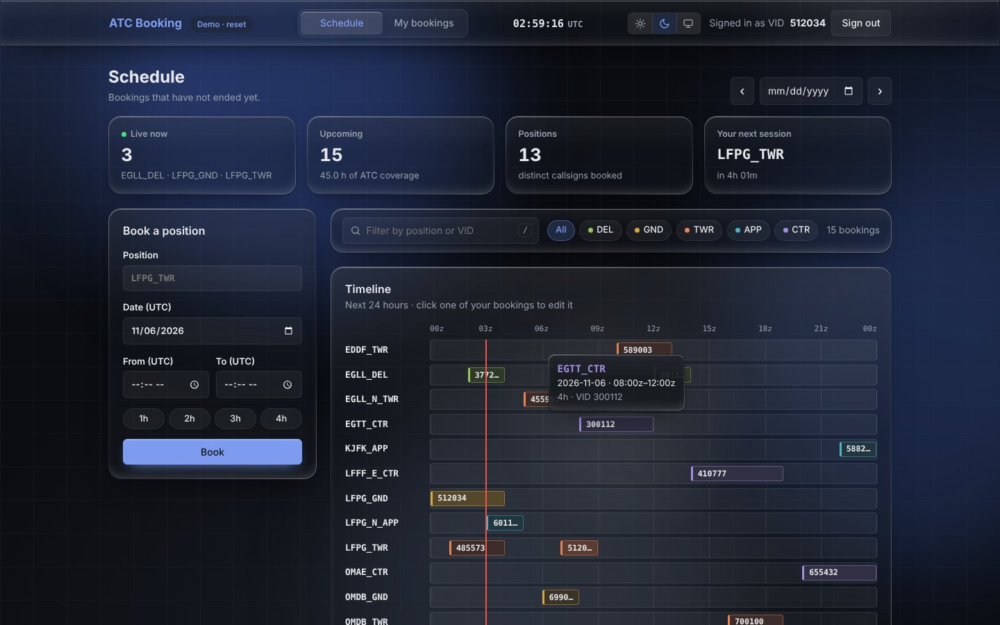
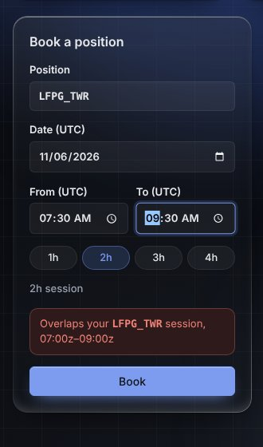
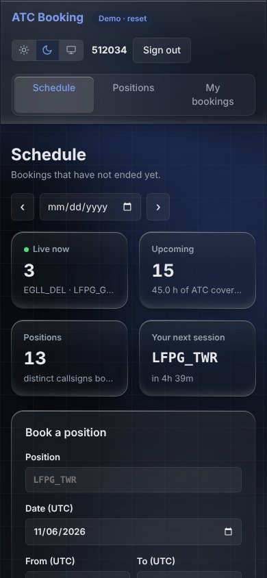
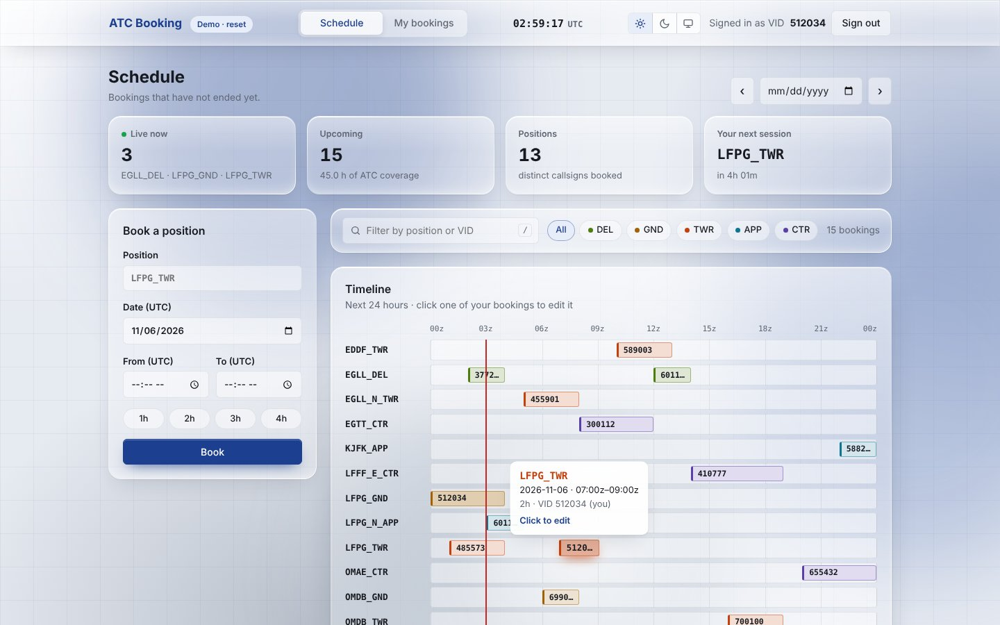
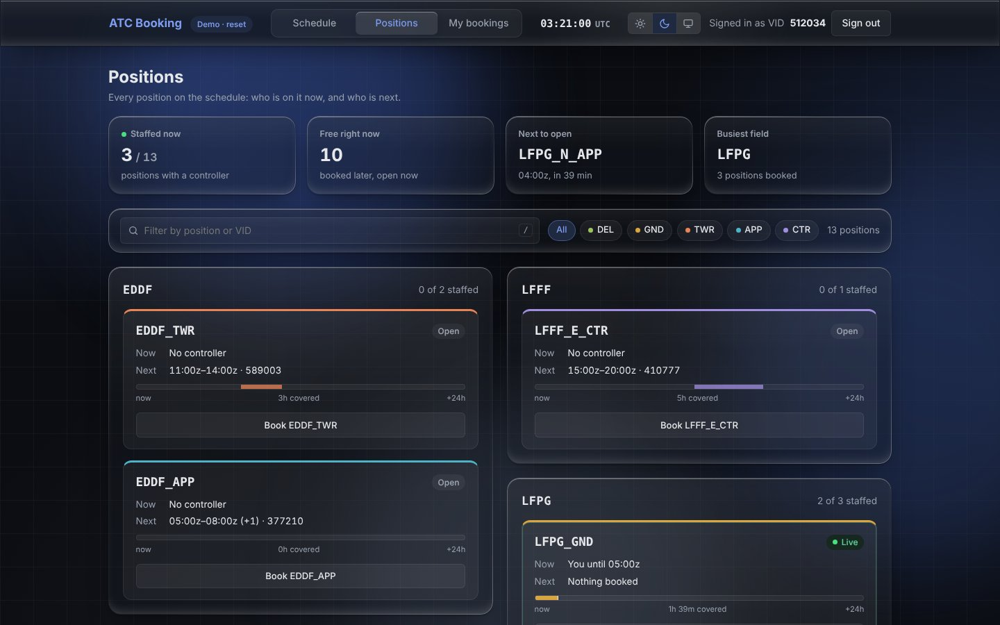

# IVAO ATC Booking

A web app to book ATC positions: a simplified version of the IVAO ATC scheduling system, built for the Web team entry exercise.

- `backend/`: NestJS API, TypeORM with SQLite
- `frontend/`: React + TypeScript (Vite)

**Live demo: https://etihadairways1028-beep.github.io/ivao-atc-booking/**. This is the static demo build (see [Static demo](#static-demo)), served from the `gh-pages` branch. It runs entirely in your browser, so try any VID, for example `512034`.



## Quick start

Requires Node.js 20 or later. From the repository root:

```bash
npm run setup   # installs the root, backend and frontend dependencies
npm run seed    # optional: adds demo bookings, some of them live right now
npm run dev     # API on http://localhost:3000, UI on http://localhost:5173
```

Open http://localhost:5173 and sign in with any VID (try `512034` or `485573` with the demo data). The API docs are at http://localhost:3000/api/docs.

Each app can also run on its own: `npm run start:dev` in `backend/` and `npm run dev` in `frontend/`.

| Command (from the root) | What it does |
| --- | --- |
| `npm test` | Backend e2e tests (24) and frontend unit tests (17) |
| `npm run lint` | ESLint on the backend, oxlint on the frontend |
| `npm run build` | Production builds of both apps |

### Database

There is nothing to set up. The backend uses SQLite through `better-sqlite3` and creates `backend/bookings.sqlite`, with its table, on first start (TypeORM `synchronize`). To use another file, set `DATABASE_PATH`. Delete the file to start over.

### Static demo

`npm run build:demo` in `frontend/` builds a version with no server: an in-browser implementation of the API with the same rules and messages (`src/demoApi.ts`) keeps data in `localStorage`. It is meant for showing the UI without running anything. The NestJS backend remains the reference, and it is the one under test. The `gh-pages` branch holds that build and is what GitHub Pages serves.

## Features

**Schedule**
- Upcoming bookings, or any UTC day, including past ones. Previous and next buttons move between days.
- A 24-hour timeline of every booked position, coloured by facility type, with a "now" marker. Hovering a bar shows its details; clicking one of your own upcoming bars opens it for editing.
- The required table, sorted by position.
- A search box (press `/` to focus it) that matches positions and VIDs, plus facility filters.
- Stat tiles: who's live now, upcoming coverage in hours, distinct positions, and a countdown to your next session.

**Booking**
- Position, date and UTC times, with 1h–4h quick durations. An end time before the start time means the session ends the next day.
- Before you submit, the form shows what's already booked on that position that day, and warns when your times would overlap someone else's booking or one of your own. The server still makes the final call.
- Edit and delete your own bookings before they start, with an in-page confirmation for deletes.

**Positions**
- Every position on the schedule, grouped by airport or FIR: who is controlling it now and until when, who is next, and its coverage over the next 24 hours.
- Totals for staffed and free positions, the next one to open and the busiest field. "Book" opens the form with that position filled in.

**My bookings**
- Your next session up front (with a countdown, or a progress bar while you're on position), your week at a glance, every upcoming session, your history, and your hours per position.

**Everywhere**
- A footer with the booking rules and your offset from UTC.
- Light, dark or system theme. Animated page changes, notifications, a responsive layout, and keyboard-accessible controls. Motion is turned off for users who ask their system for reduced motion.

<p>
  
  
</p>





## API

All routes are under `/api`, and interactive docs are served at `/api/docs` (Swagger). Routes marked 🔒 need the user's VID in the `X-IVAO-VID` header.

| Method | Route | Description |
| --- | --- | --- |
| GET | `/bookings` | Upcoming bookings (not ended yet), sorted by position |
| GET | `/bookings?date=YYYY-MM-DD` | Bookings overlapping that UTC day, past days included |
| GET 🔒 | `/bookings/mine` | Your own bookings, newest first, past ones included |
| GET | `/bookings/current/:callsign` | VID of whoever has the position booked right now (the Aurora idea from the brief) |
| POST 🔒 | `/bookings` | Book a position: `{ callsign, startsAt, endsAt }` |
| PUT 🔒 | `/bookings/:id` | Edit one of your bookings (same body) |
| DELETE 🔒 | `/bookings/:id` | Delete one of your bookings |

Errors use Nest's standard shape (`{ statusCode, message, error }`): 400 for invalid input, 401 without a valid VID, 403 for someone else's or an already started booking, 404 for an unknown id, 409 for an overlap.

## Booking rules

- Times are UTC everywhere, in the API and in the UI.
- A booking has to start in the future, end after it starts, and last 12 hours at most. The 12-hour limit stops anyone from blocking a position for days.
- The position must be free for the whole period, and the user can't be booked on another position at the same time. Back-to-back bookings (10:00–12:00 then 12:00–14:00) are allowed.
- Only the owner can edit or delete a booking, and only before it starts. When you edit a booking, it doesn't conflict with itself.
- Callsigns are validated (`LFPG_TWR`, `LFPG_N_APP`, `LFFF_E_CTR`...) and upper-cased.

## Project layout

```
backend/src/
  auth/          VidGuard (reads and checks the VID header) and the @Vid() decorator
  bookings/      entity, DTOs, controller and service (all booking rules live here)
  app.setup.ts   global prefix and validation, shared by main.ts and the tests
  seed.ts        demo data
backend/test/    e2e tests against an in-memory database

frontend/src/
  pages/         Schedule, Positions and My bookings
  components/    form, timeline, table, filters, dialogs, toasts...
  hooks/         data loading, routing, theme, toasts, confirm dialog...
  api.ts         HTTP client (or the in-browser demo API in demo builds)
  model.ts       shared types and the callsign rule
```

## Choices worth mentioning

- **Identification**: as the brief asks, the VID header is trusted as-is. A guard checks that it looks like a VID, and a `@Vid()` decorator passes it to the handlers. The owner always comes from the header, never from the body. The validation pipe rejects unknown fields, so a client can't send `vid` or `id` in a payload.
- **Concurrency**: the conflict check and the write happen in one transaction, and SQLite runs write transactions one at a time. So two simultaneous requests can't both get the same slot (there's a test for this). With Postgres I would add an exclusion constraint on `(callsign, tstzrange)` as a database-level guarantee.
- **Performance**: there are indexes on `(callsign, startsAt)` and `(vid, startsAt)`, which the overlap and listing queries use. The schedule's timeline, table and stats all come from one list request.
- **Data loading**: one small `useApiData` hook loads data per request key and aborts outdated requests, so a slow response never overwrites a newer one. Loading states are derived from that key rather than toggled by hand.
- **Routing**: two pages don't need a router library. The page lives in the URL hash (`#schedule`, `#positions`, `#my-bookings`), so reloads and the back button work. Page changes go through the View Transitions API where the browser has it.
- **Styling**: there's no CSS library, just one stylesheet built on CSS variables, with a theme for light and one for dark. The theme is applied before React loads, so the page never flashes the wrong one. The frosted-glass panels use backdrop blur and a light edge. (The CSS minifier collapses `backdrop-filter` and `-webkit-backdrop-filter` into the prefixed one only, which Chrome ignores, so the source only writes the standard property and lets the build add the prefix.) One page-level pointer listener drives the highlight that follows the cursor.
- **Frontend tooling**: Create React App has been deprecated since 2025 and no longer installs cleanly with current React. I used Vite, which is just the dev server and bundler; the app itself is plain React with no framework on top. In development, Vite proxies `/api` to the backend, so no CORS setup is needed.
- `synchronize: true` is fine for an exercise. A real deployment would use migrations.
